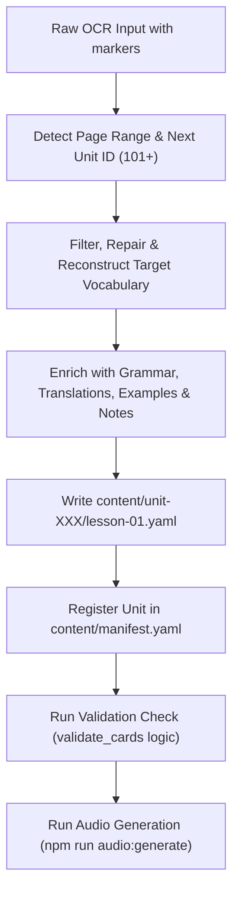

# Klik A1 Deck Builder Skill

This skill guides AI agents in converting raw, optical-character-recognized (OCR) extractions from the textbook **"Κλικ στα Ελληνικά Α1"** (Klik sta Ellinika A1) into production-grade Modern Greek flashcard units for the **Greek Flashcard Deck Engine**.

---

## 1. Core Principles & Conventions

### 1.1 Unit Numbering & Scope
- **Unit IDs:** Units created from "Κλικ στα Ελληνικά Α1" must begin at **101** and increment sequentially: `unit-101`, `unit-102`, `unit-103`, etc.
  - Base thematic units (`unit-01` to `unit-06`) are reserved for core thematic curricula.
  - Series 101+ is explicitly reserved for textbook-aligned lessons.
- **Card IDs:** Must follow the pattern `A1-U{UnitNumber}-{Index:03d}`, e.g., `A1-U101-001`, `A1-U101-002`.

### 1.2 Unit Title Naming Rule (Page Range Requirement)
The title of the unit **must explicitly denote the page range involved** from the book:
- Format: `Κλικ στα Ελληνικά Α1: Σελίδες {start}-{end} ({Greek Subtitle / Topic})`
- English/bilingual subtitle can also be appended or included in lesson titles.
- Example:
  - Unit Title: `Κλικ στα Ελληνικά Α1: Σελίδες 25-41 (Εισαγωγική Ενότητα - Ήχοι, Γράμματα & Πρώτες Λέξεις)`
  - Manifest Unit Title: `Κλικ στα Ελληνικά Α1: Σελίδες 25-41 (Εισαγωγική Ενότητα - Ήχοι, Γράμματα & Πρώτες Λέξεις)`
  - Lesson Title: `Εισαγωγική Ενότητα: Ήχοι, Αλφάβητο & Βασικό Λεξιλόγιο (Pages 25-41)`

---

## 2. OCR Cleaning & Linguistic Normalization

Raw textbook OCR extractions typically contain artifacts, typos, fragmented syllables, and fill-in-the-blank placeholders. The agent must apply the following normalization rules:

1. **Greek Monotonic Accentuation (*Tonos*):**
   - Modern Greek requires accents on all polysyllabic words (e.g. `νερό`, `παγωτό`, `καλημέρα`).
   - Words with diphthongs/digraphs where vowels separate require *dialytika* (`ϊ`, `ϋ`) or accented dialytika (`ΐ`, `ΰ`), e.g., `το προϊόν`, `το καΐκι`, `το μαγιό`.
2. **Definite Articles for Nouns:**
   - **Every noun in the `greek` field must include its definite article** (`ο `, `η `, `το `, `οι `, `τα `).
   - Never write bare nouns like `λεμόνι`; always write `το λεμόνι`.
3. **Common OCR Character Substitutions:**
   - Latin letters replacing Greek letters (e.g. Latin `v` vs Greek `ν`, Latin `p` vs Greek `ρ`, Latin `o` vs Greek `ο`, Latin `x` vs Greek `χ`). Normalize all characters to Unicode Greek block (`U+0370` to `U+03FF`).
   - Fill-in-the-blank exercise items (e.g. `_ατερν_μ`, `__ν__ουλιπά`) must be resolved to their proper target word (e.g., `η τουλίπα`).
   - Exercise typos or blurred scans (e.g., `γάδι` $\to$ `το λάδι`, `σουζι` $\to$ `το σούσι`, `Μαψιό` $\to$ `το μαγιό`, `ΤΖΑΝΤΑ` $\to$ `η τσάντα`, `βάιτος` $\to$ `το βάζο`) must be corrected to authentic Modern Greek.

---

## 3. Flashcard Schema Specification

Each card entry in `content/unit-{XXX}/lesson-01.yaml` must adhere to the project's Single Source of Truth schema:

```yaml
- id: "A1-U101-001"
  greek: "το αεροπλάνο"
  phonetic_hint: ""
  english: "airplane / plane"
  notes: "Neuter noun in -ο with plural in -α (τα αεροπλάνα). Stress on the penult."
  gender_or_pos: "noun (neuter)"
  audio: null                    # populated when TTS is generated
  status: "pending_tts"          # "pending_tts" | "verified"
  example_el: "Το αεροπλάνο φτάνει στην Αθήνα το απόγευμα."
  example_en: "The airplane arrives in Athens in the afternoon."
  grammatical_info:
    part_of_speech: "noun (neuter)"
    plural: "τα αεροπλάνα"
    accusative_singular: "το αεροπλάνο"
  keg_communicative_function: "Naming transportation vehicles and travel basics"
```

### 3.1 Grammatical Info Requirements
- **Nouns:**
  - `part_of_speech`: `noun (masculine)` | `noun (feminine)` | `noun (neuter)`
  - `plural`: Full plural with article (e.g., `οι μπλούζες`, `τα πορτοφόλια`)
  - `accusative_singular`: Singular with accusative article (e.g., `την μπλούζα`, `το πορτοφόλι`)
- **Verbs:**
  - `part_of_speech`: `verb`
  - `verb_type`: `Type A (active regular)` | `Type B1` | `Type B2` | `irregular`
  - `third_person_singular`: e.g. `ταξιδεύει`, `τρώει`
  - `first_person_plural`: e.g. `ταξιδεύουμε`, `τρώμε`
- **Adjectives:**
  - `part_of_speech`: `adjective`
  - `forms`: e.g. `κρύος, -α, -ο`

---

## 4. Agent Execution Workflow

When receiving an OCR extraction:



### Step 1: Determine the Next Unit Number
Check `content/manifest.yaml` to find the highest existing unit number in the 100+ range. If none exists, start at **101** (`unit-101`).

### Step 2: Determine Page Range & Title
Inspect the input for page headers like `<!-- PAGE 25 -->` and `<!-- PAGE 41 -->`.
Set the unit title:
`Κλικ στα Ελληνικά Α1: Σελίδες {start}-{end} ({Theme})`

### Step 3: Extract and Curate Vocabulary
1. Scan every exercise and table in the pages.
2. Select high-frequency, core CEFR A1 items.
3. Eliminate duplicate words practicing the same phoneme across multiple exercises.
4. Clean and fix OCR errors to standard Greek.

### Step 4: Write YAML Lesson File
Write the structured lesson to `content/unit-{XXX}/lesson-01.yaml`.
Ensure all mandatory fields are present.

### Step 5: Update `content/manifest.yaml`
Add the unit to `content/manifest.yaml`:
```yaml
- id: "unit-101"
  title: "Κλικ στα Ελληνικά Α1: Σελίδες 25-41 (Εισαγωγική Ενότητα - Ήχοι, Γράμματα & Πρώτες Λέξεις)"
  order: 101
  lessons:
    - id: "lesson-01"
      file: "unit-101/lesson-01.yaml"
      title: "Εισαγωγική Ενότητα: Ήχοι, Αλφάβητο & Βασικό Λεξιλόγιο (Pages 25-41)"
```

### Step 6: Validate
Run Python or Node validation script to verify that:
- Every entry has required keys.
- Every noun starts with an article.
- Every verb has required inflection fields.
- YAML structure is valid.

### Step 7: Generate Audio Assets
Execute audio synthesis via Google Cloud TTS Chirp 3:
```powershell
python scripts/generate_audio_assets.py --unit unit-101
```
Or run `npm run audio:generate`.
Verify that cards update to `status: verified` with permanent MP3 filenames.
